<!-- SPDX-FileCopyrightText: © 2026 Vahid Mohammadi -->
<!-- SPDX-License-Identifier: GPL-3.0-only -->

<div align="center">

# Veda

**The Agentic-Native Operating System**

An operating system written in Rust, with a voice agent built into the system.

[](LICENSE)
[](documentation/RUST.md)
[](#quick-start)

[Screenshots](#screenshots) · [Quick start](#quick-start) · [Make an app agentic](#make-an-app-agentic) · [Architecture](#architecture) · [Documentation](#documentation)

</div>

[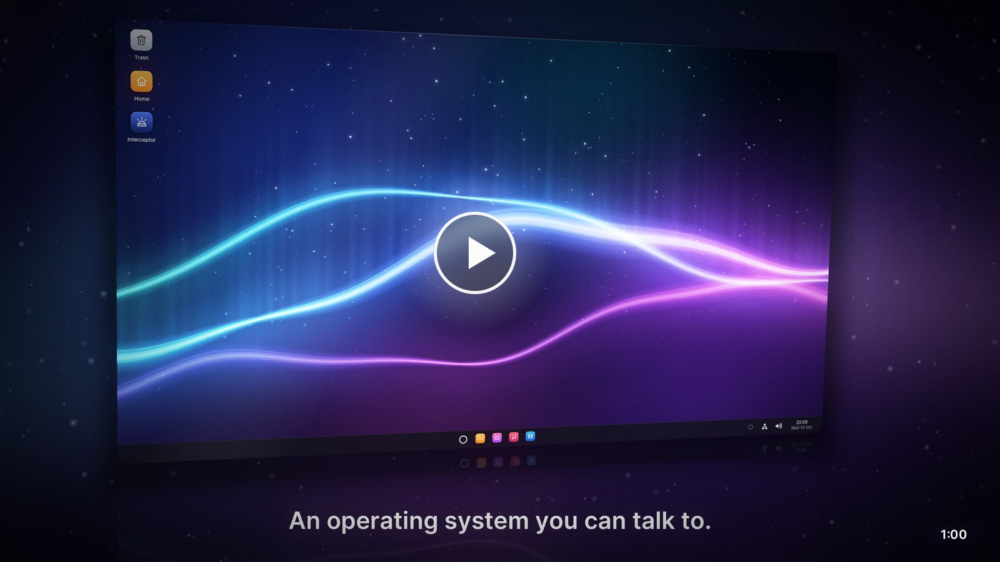](https://www.youtube.com/watch?v=gXIS-6cVNAk)

Say *"Hey Veda, switch my wallpaper to the dunes"* and it is done. The agent
works in every application through the same code as your keyboard and
mouse, and asks you before anything that is hard to undo. Everything here
is Rust, from the UEFI bootloader and the microkernel to the window system
and the applications.

<table>
  <tr>
    <td width="33%" valign="top"><b>An agent in the system</b><br>A service from boot that wakes when you say its name. Its model, its voice and even its name are settings.</td>
    <td width="33%" valign="top"><b>Actions, not screen scraping</b><br>Applications declare typed actions that run the same code as the keyboard and mouse. The built-in ones offer more than 100.</td>
    <td width="33%" valign="top"><b>Consent the model cannot skip</b><br>The system holds sensitive and destructive actions until you allow them, and only the desktop shell can answer.</td>
  </tr>
  <tr>
    <td width="33%" valign="top"><b>A microkernel in Rust</b><br>Capabilities, SMP, and services in user space that restart by themselves. Applications get Rust's standard library.</td>
    <td width="33%" valign="top"><b>Linux's drivers, contained</b><br>Linux drives the hardware in a VM on Veda's own hypervisor, held in by the IOMMU and restarted if it crashes.</td>
    <td width="33%" valign="top"><b>A complete desktop</b><br>A compositing window system, a lock screen, a web browser on WebKit, OpenGL ES 3.0, GCC in the Terminal, WPA3 Wi-Fi and a firewall that asks first.</td>
  </tr>
</table>

## Screenshots

<table>
  <tr>
    <td colspan="2"><p align="center"><b>Desktop</b></p>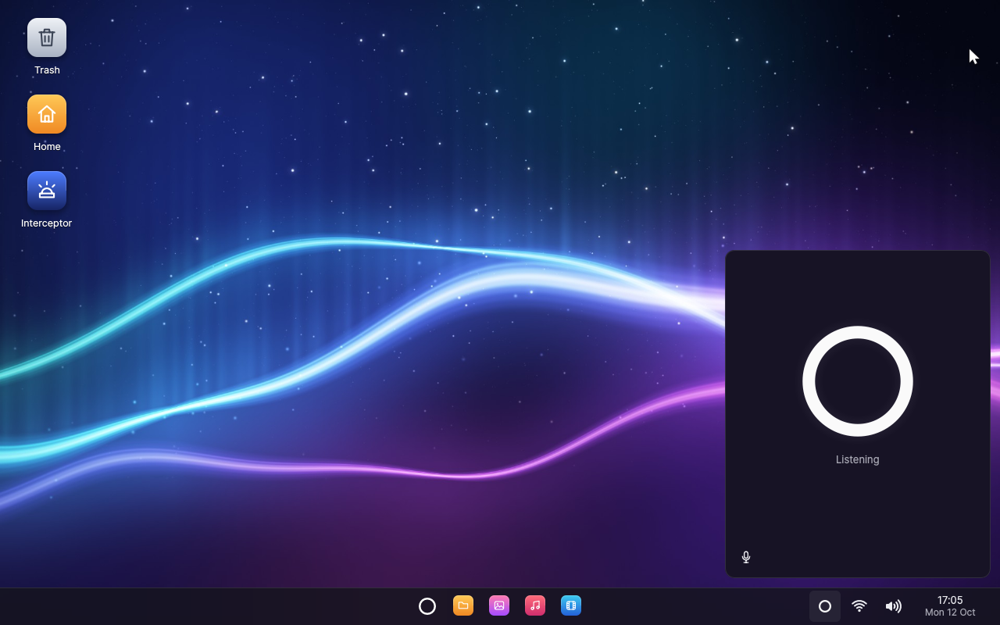</td>
  </tr>
  <tr>
    <td width="50%"><p align="center"><b>Browser</b></p>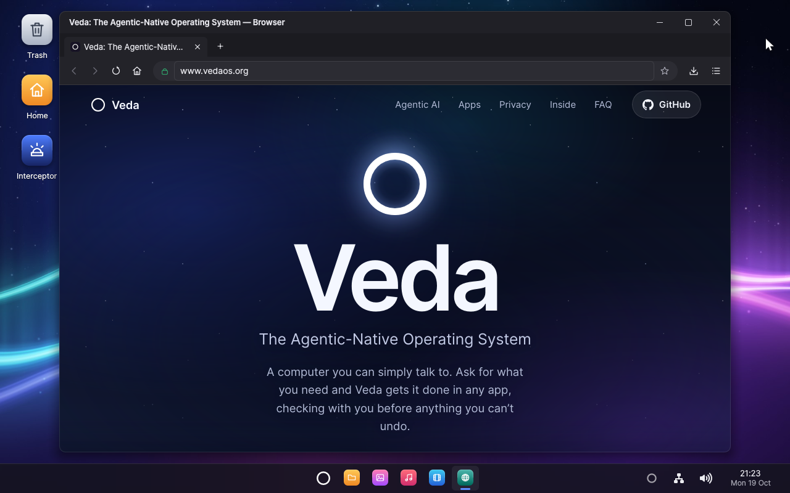</td>
    <td width="50%"><p align="center"><b>Text Editor</b></p>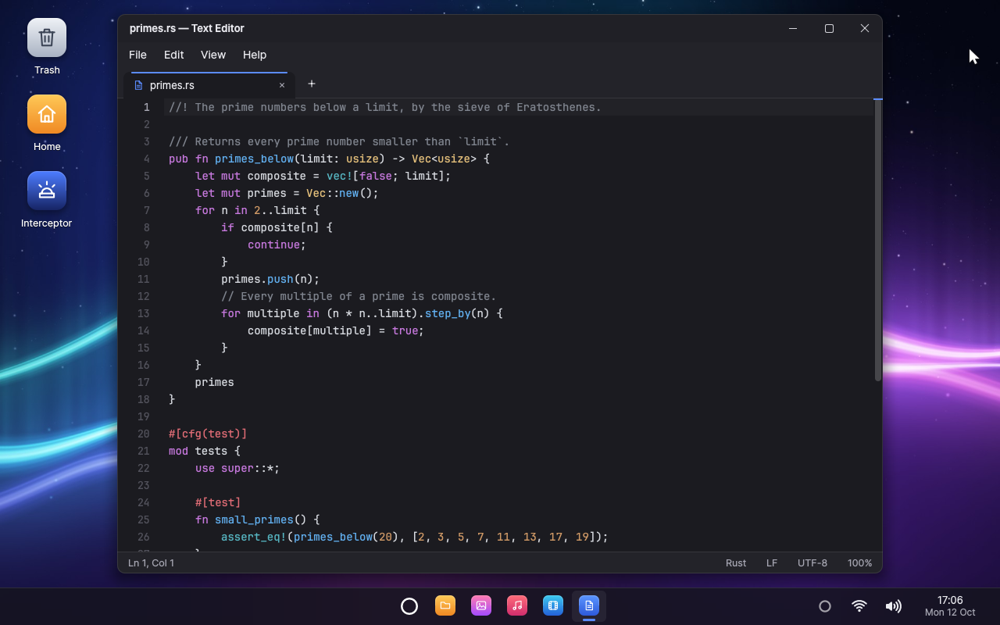</td>
  </tr>
  <tr>
    <td><p align="center"><b>Photos</b></p>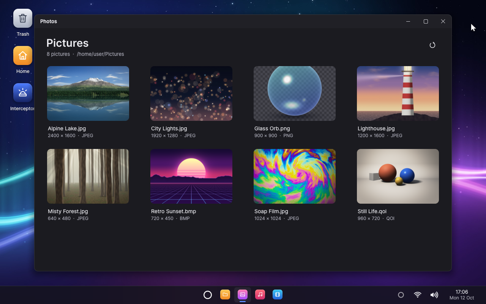</td>
    <td><p align="center"><b>Music</b></p>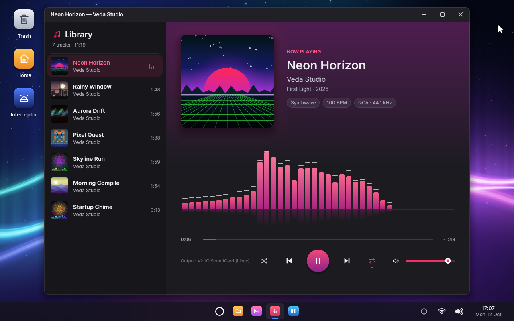</td>
  </tr>
  <tr>
    <td><p align="center"><b>Files</b></p>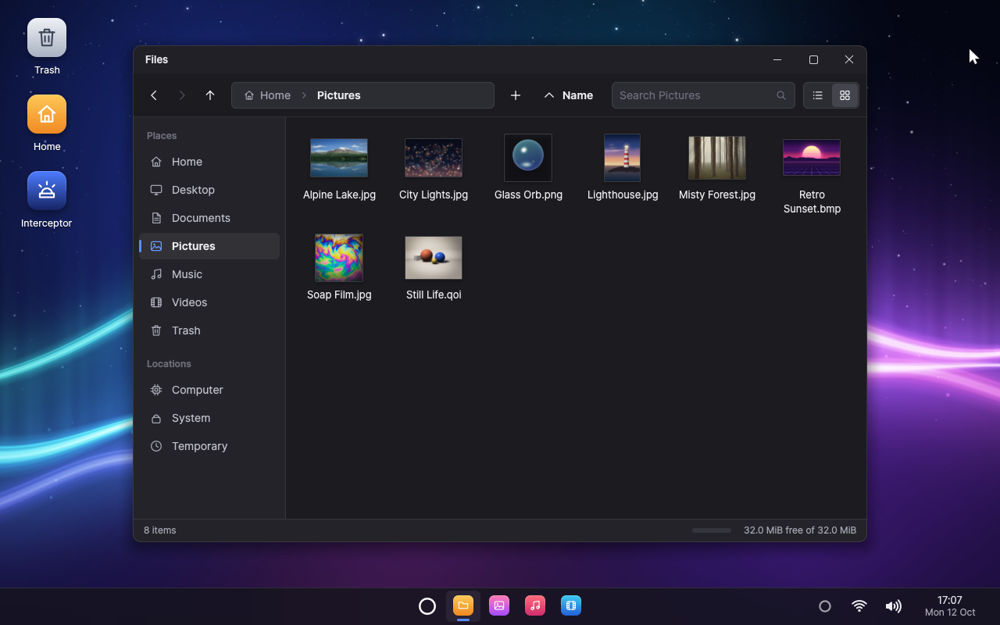</td>
    <td><p align="center"><b>Videos</b></p>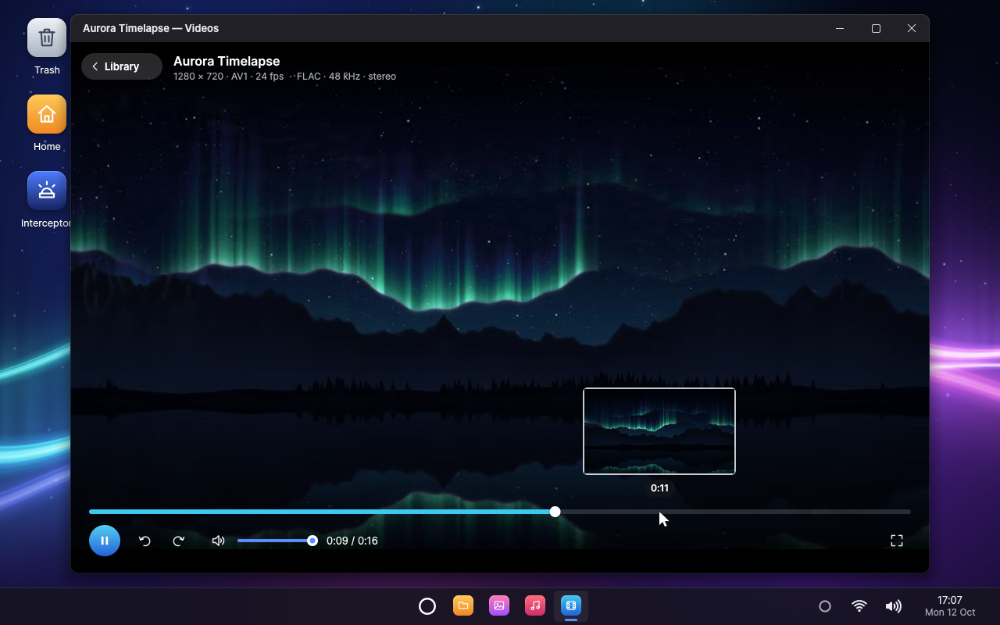</td>
  </tr>
  <tr>
    <td><p align="center"><b>Settings</b></p>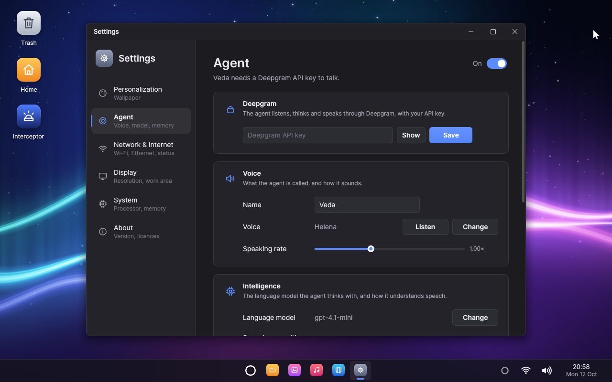</td>
    <td><p align="center"><b>Paint</b></p>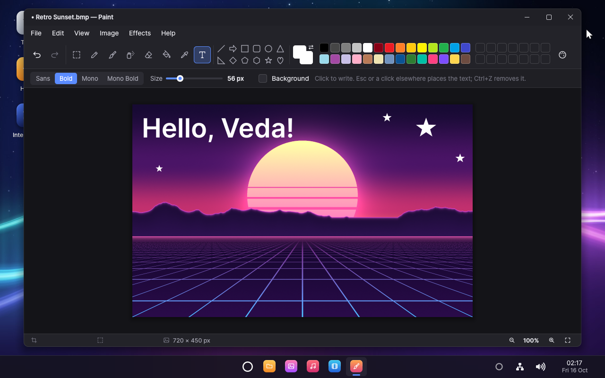</td>
  </tr>
  <tr>
    <td><p align="center"><b>Calculator</b></p>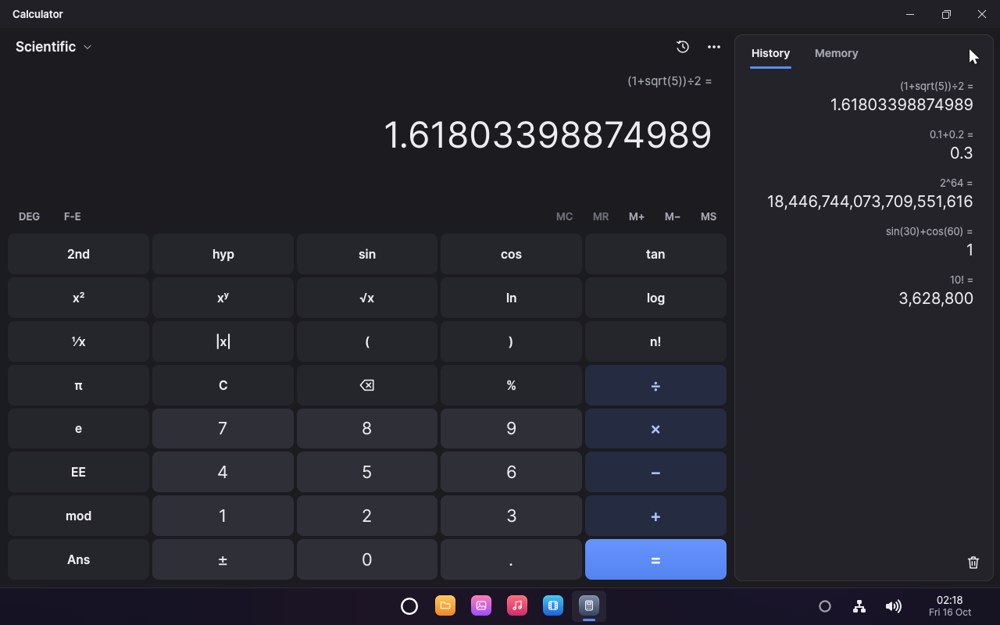</td>
    <td><p align="center"><b>Terminal</b></p>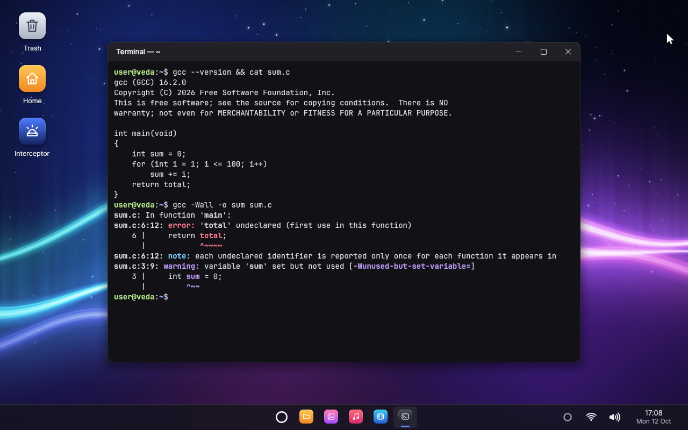</td>
  </tr>
  <tr>
    <td><p align="center"><b>Interceptor</b></p>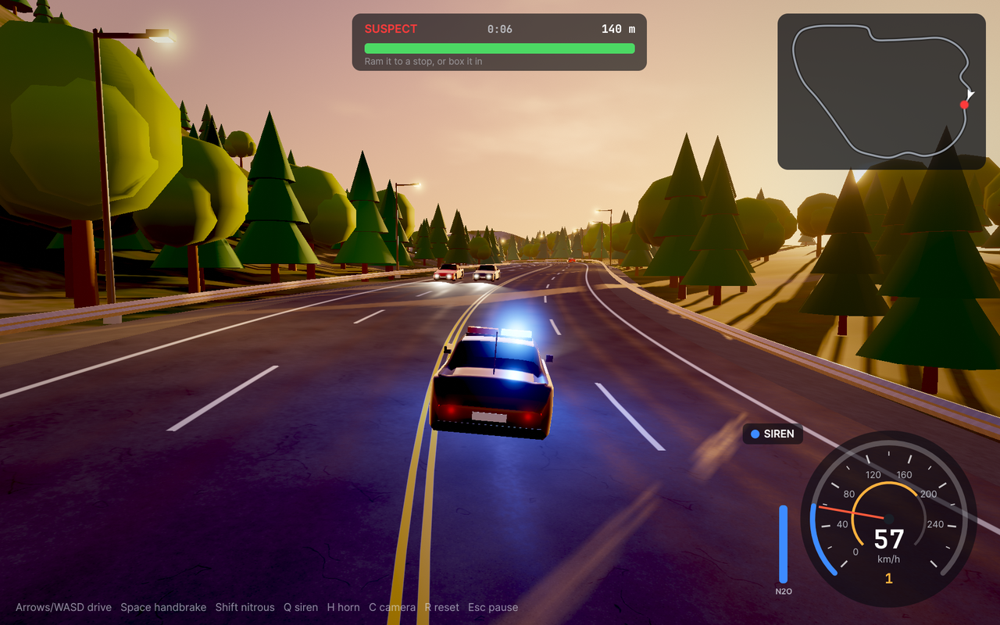</td>
    <td><p align="center"><b>Unlocking</b></p>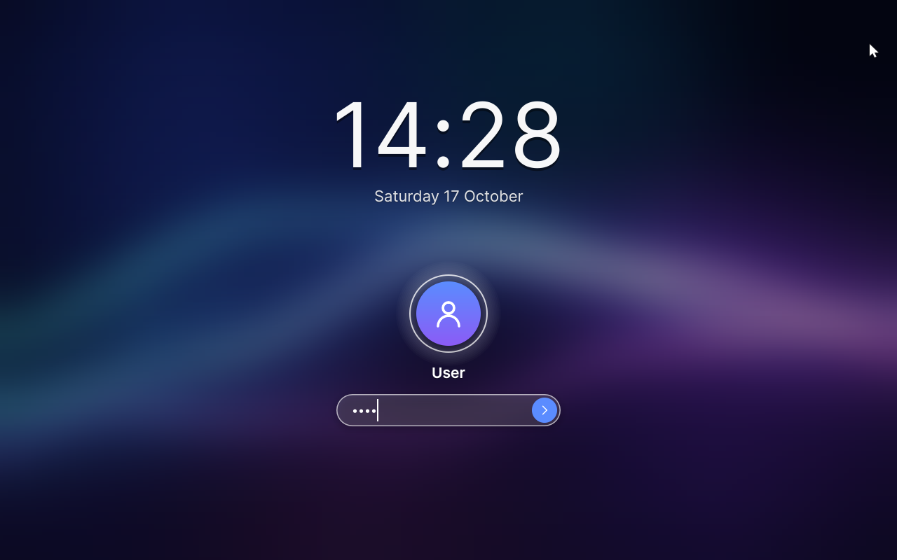</td>
  </tr>
</table>

## Quick start

Veda builds on an x86-64 Linux machine with KVM. Install
[Rust](https://rustup.rs) and the build tools:

<details>
<summary>Packages on Debian and Ubuntu</summary>

```bash
sudo apt install qemu-system-x86 qemu-system-gui qemu-system-modules-opengl ovmf \
  build-essential bc curl rsync m4 flex bison meson ninja-build cmake nasm \
  libgmp-dev libmpfr-dev libmpc-dev python3 python3-mako python3-packaging python3-yaml
```

The driver VM also needs KVM's nested virtualization (`kvm_intel nested=1`).

</details>

Then build Veda and boot it:

```bash
cargo automation doctor      # check the tools
cargo automation toolchain   # once, about half an hour: GCC, musl and Rust for Veda
cargo automation linux       # once: the driver VM's Linux and Mesa
cargo automation web         # once, an hour or more (optional): WebKit, for the browser
cargo automation python      # once, a few minutes (optional): Python, its standard library
cargo automation run         # build Veda and boot it in QEMU
```

Add a [Deepgram](https://deepgram.com) API key in **Settings → Agent**, then
say **"Hey Veda"**, click the ring on the taskbar or press **Super+Space**.
Try *"Play Neon Horizon"*, *"Show me the lighthouse photo, full screen"* or
*"Delete the City Lights photo"* (it asks you first).

**On a PC:** `cargo automation iso` writes a live system for a USB stick.
Start it in UEFI mode, with VT-x and VT-d on and Secure Boot off. It runs
from memory and leaves the PC's disks alone; see
[what it supports](documentation/DRIVERVM.md#status).

## Make an app agentic

Agent support is part of the `ui` toolkit. An application describes its
actions, reports its state and performs actions; `ui::run` registers it
with the agent service and answers the agent between frames:

```rust
use ui::agent::{self, Action, AppAgentInfo, Risk, Value, arg_path, arg_str, json, show_path};

impl ui::App for Notes {
    fn update(&mut self, ui: &mut ui::Ui) { /* ... */ }

    fn agent_info(&self) -> Option<AppAgentInfo> {
        Some(agent::info(
            "A notes app: one note per file in ~/Notes.",
            vec![
                Action::new("add_line", "Adds a line at the end of the note shown")
                    .param("text", "string", "The line", true)
                    .build(),
                Action::new("delete_note", "Deletes a note for good")
                    .param("path", "string", "The note's file, such as ~/Notes/Ideas.txt", true)
                    .risk(Risk::Destructive)
                    .build(),
            ],
        ))
    }

    fn agent_state(&self) -> Value {
        json!({ "note": self.title.as_str(), "lines": self.lines.len() })
    }

    fn agent_invoke(&mut self, action: &str, args: &Value) -> Result<Value, String> {
        match action {
            "add_line" => { self.append(arg_str(args, "text")?); Ok(json!({ "lines": self.lines.len() })) }
            "delete_note" => {
                let path = arg_path(args, "path")?;
                self.delete(&path).map_err(|e| format!("{} could not be deleted: {e}", show_path(&path)))?;
                Ok(json!({ "deleted": show_path(&path) }))
            }
            other => Err(format!("Notes has no action called {other}")),
        }
    }
}
```

Declare each action's risk and run it through the same code as the keyboard
and mouse: consent, memory and the conversation are the system's job. The
[full guide](documentation/AGENT.md#making-an-application-agent-compatible)
covers the rest.

## Architecture

| Layer | What it is |
|-------|------------|
| **Kernel** | A capability-based microkernel: isolation, scheduling, memory and IPC, on SMP with tickless timers |
| **Services** | Drivers, the file system, the window system, audio, networking and the agent, in user space; `init` restarts them if they fail |
| **Drivers** | Veda drives its own disks; Linux drives the rest in the [driver VM](documentation/DRIVERVM.md), on Veda's hypervisor |
| **Graphics** | A compositing window system, the immediate-mode `ui` toolkit, and OpenGL ES 3.0 on the GPU through Mesa or in software |
| **Programs** | Rust's standard library, and C with GCC 16 and musl, over `posix`, a POSIX layer in Rust; static or dynamically linked, loading shared libraries at run time |
| **Network** | IPv4 and IPv6, TLS 1.3, WPA3 Wi-Fi, and a firewall in stealth mode by default |

Where a proven library exists, Veda uses it: smoltcp, rustls, RustCrypto,
FFmpeg, dav1d, glam, WPE WebKit and [more](documentation/DEPENDENCIES.md).

## Testing

```bash
cargo automation test        # unit tests on the host, then integration tests inside Veda
cargo automation test --ui   # plus the GUI and agent scripts
```

The scripts click through the desktop and the applications, and break
things on purpose (Linux's drivers crash, a cable is pulled, services are
killed) to check that Veda recovers by itself. The agent's scripts talk to
a stand-in for Deepgram, so they are offline, deterministic and free.

## Documentation

| Guide | Covers |
|-------|--------|
| [The agent](documentation/AGENT.md) | How the agent works, consent, memory, and agent-compatible applications |
| [Architecture](documentation/ARCHITECTURE.md) | How the system fits together |
| [The driver VM](documentation/DRIVERVM.md) | The hypervisor, the IOMMU and Linux's drivers |
| [Networking](documentation/NETWORKING.md) | The network and Wi-Fi services, the firewall and TLS |
| [The web browser](documentation/BROWSER.md) | The browser, WebKit's port to Veda, and how pages are drawn |
| [C on Veda](documentation/C.md) and [Rust on Veda](documentation/RUST.md) | Programs, the POSIX layer and the toolchains |
| [Linking and loading](documentation/LINKING.md) | Static and dynamically linked programs, shared libraries, and loading them at run time from C, C++, Rust and Python |
| [Python on Veda](documentation/PYTHON.md) | Python, its standard library, and CPython's port |
| [Packages](documentation/PACKAGES.md) | Installing software with `pkg`: the package manager, signed repositories, and changes that survive the power going |
| [Developing](documentation/DEVELOPING.md) | Commands, the system image and writing applications |
| [Libraries](documentation/DEPENDENCIES.md) | What Veda builds on, and what it keeps of its own |
| [Coding conventions](documentation/CODING.md) | How the code is written |

## Contributing

Contributions are welcome. [Contributing](CONTRIBUTING.md) covers how to
propose a change, the standards it meets, and how it is tested and
reviewed.

## License

Veda is free software under the
[GNU General Public License, version 3](LICENSE). Copyright © 2026 Vahid
Mohammadi. Its other parts (its fonts, firmware, toolchains, video
decoder, web engine, Python and the crates its programs are built with)
keep their own licences, whose texts the system carries in
`/system/licences` and About Veda shows; see
[Licensing](documentation/LICENSING.md).
